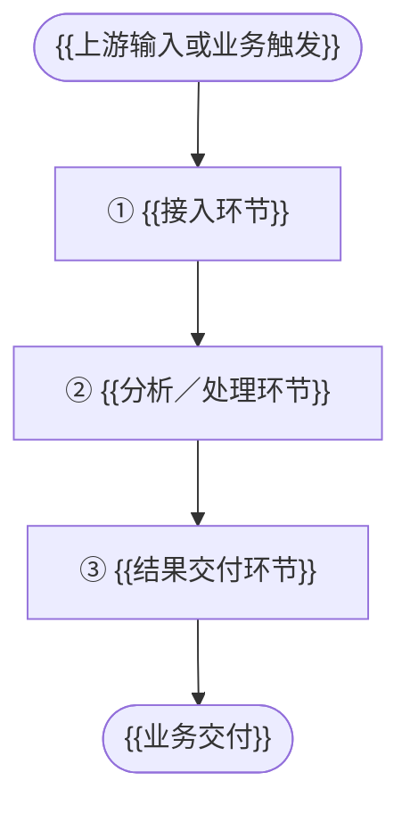
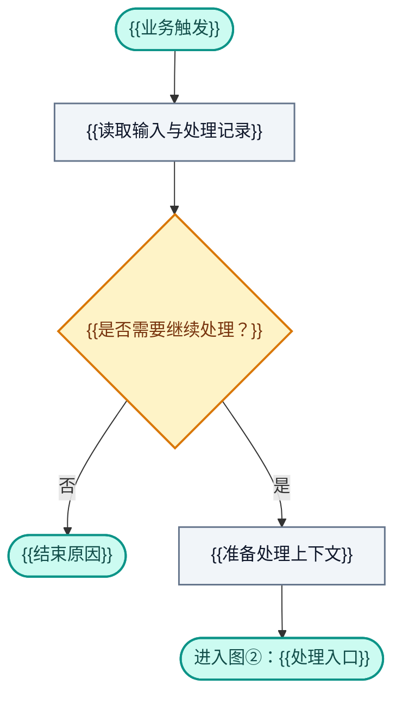
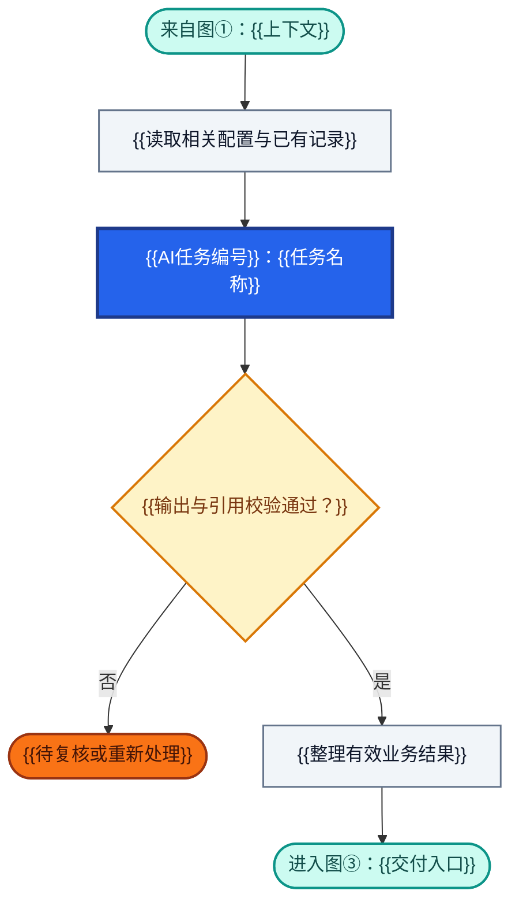
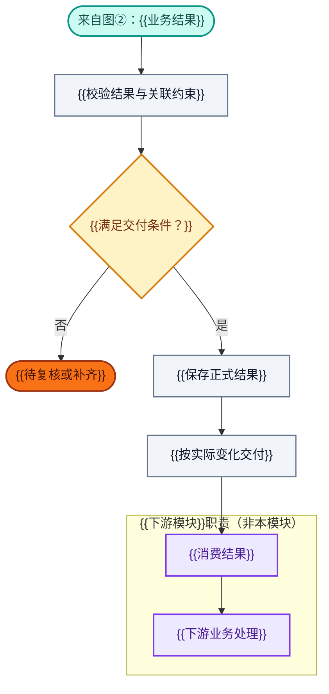

# {{系统／模块名称}}：业务架构与领域设计

> **文档版本**：{{版本及讨论状态}}\
> **编制日期**：{{YYYY-MM-DD}}\
> **设计范围**：{{系统／业务层／模块／首版范围}}\
> **设计基线**：{{已有业务对象、上下游和版本约束}}\
> **设计依据**：{{需求、纪要或现有文档的位置与版本}}\
> **内容约定**：区分已确认设计、建议方案与待讨论项；未确定的规则、字段、算法、Prompt 或接口规范标注“待讨论”。

<!-- 撰写说明：替换占位符；无法确定时写“待讨论”。本模板的三阶段图是可复制骨架，不规定实际阶段数量。交付正文前移除撰写说明和不适用的示例。 -->

## 1. 业务能力与职责设计

### 1.1 业务定位与总体职责

{{本模块将什么输入转化为什么业务结果，为谁服务，解决什么问题。}}

本模块主要回答：{{核心业务问题}}。对 {{本模块承担责任的业务结果}} 负责。

### 1.2 核心业务能力与责任

| 业务能力 | 回答的业务问题 | 本模块承担的责任 | 主要交付结果 |
| --- | --- | --- | --- |
| {{能力名称}} | {{业务问题}} | {{职责及责任对象}} | {{可交付的业务结果}} |

**横向质量与追溯职责**：{{适用的来源追溯、重复处理、引用校验、历史保留及复核职责；仅填写有依据的要求。}}

**能力与环节的对应**：{{说明上述能力如何映射到第 1.3 节的处理环节；流程见第 2 章。}}

### 1.3 业务能力划分

| 环节 | 业务能力／环节名称 | 输入 | 核心处理 | 主要输出 |
| --- | --- | --- | --- | --- |
| ① | {{接入环节}} | {{输入}} | {{核心处理}} | {{有效上下文或处理结果}} |
| ② | {{分析／处理环节}} | {{上下文}} | {{核心处理}} | {{候选或业务结果}} |
| ③ | {{结果交付环节}} | {{待交付结果}} | {{校验、保存或交付}} | {{正式业务结果}} |

<!-- 按实际业务增删环节，并同步总体图、详图、步骤编号和接口。能力与环节不必一一对应。 -->

### 1.4 首版职责覆盖范围

| 维度 | 首版范围与责任 | 讨论状态 |
| --- | --- | --- |
| 业务领域与服务对象 | {{覆盖范围}} | {{已确认／建议／待讨论}} |
| 输入与触发 | {{输入类型与适用触发}} | {{状态}} |
| 核心业务对象 | {{对象范围与身份边界}} | {{状态}} |
| 配置与共享资源 | {{共享配置及维护责任}} | {{状态}} |
| 生命周期与历史 | {{跟踪、版本或历史的责任}} | {{状态}} |
| 下游交付 | {{交付范围}} | {{状态}} |

### 1.5 上下游职责分工

| 业务层／模块 | 承担的业务职责 | 核心业务产物 | 与本模块的协作 |
| --- | --- | --- | --- |
| {{上游}} | {{上游责任}} | {{输入来源}} | {{输入与证据}} |
| {{本模块}} | {{本模块责任}} | {{核心输出}} | {{处理与交付}} |
| {{下游}} | {{下游责任}} | {{下游产物}} | {{如何消费本模块结果}} |

**对象与语义边界**：{{说明跨模块相似概念是否同一身份、何时可映射及谁负责维护。}}

### 1.6 职责边界与暂不承担事项

- {{由上游负责的事项及本模块如何复用。}}
- {{交付下游后由下游负责的事项。}}
- {{首版明确排除的范围及原因。}}

## 2. 业务架构设计

### 2.1 总体业务流程

**流程关键约束**：{{说明顺序依赖、候选与正式结果的界线、一对多处理及一致完成要求；无依据时不补造约束。}}

### 2.2 详细业务流程

各图与第 1.3 节的实际业务环节对应。圆角节点表示入口、出口、正常结束或暂停；节点写短动作，详细字段和口径放在图下。

| 详图 | 对应业务环节 | 入口 | 出口及衔接 |
| --- | --- | --- | --- |
| 图① | {{接入环节}} | {{业务触发}} | {{图②或结束}} |
| 图② | {{分析／处理环节}} | {{有效上下文}} | {{图③或复核}} |
| 图③ | {{结果交付环节}} | {{可交付结果}} | {{下游或复核}} |

**颜色图例**：蓝底白字＝AI 分析；灰色＝程序处理；浅黄＝规则校验与结果分支；橙色＝待复核或条件待确认；青绿＝入口、出口与正常结束；紫色＝下游职责。

**AI 编号口径**：{{沿用第 6.1 节的任务编号；同一任务跨图保持一致。无 AI 时标明不适用，并删除 AI 节点与图例。}}

#### 2.2.1 图①：{{接入环节名称}}

| 步骤 | 业务工作 | 输入与输出 | 规则引用 |
| --- | --- | --- | --- |
| 1.1 | {{接收输入}} | {{输入与输出}} | {{规则编号}} |
| 1.2 | {{继续／结束判断}} | {{判断结果及原因}} | {{规则编号}} |
| 1.3 | {{准备上下文}} | {{下一阶段输入}} | {{规则编号}} |

**处理口径与边界**：{{说明重复、无增量、输入缺失等适用分支；已由上游完成的工作是否需要复用。}}

#### 2.2.2 图②：{{分析／处理环节名称}}

<!-- 此图仅作为存在 AI 时的骨架。无 AI 时改为真实业务动作和相应责任配色，不保留虚构任务。 -->

| 步骤 | 业务工作 | 应形成的内容 | 规则引用 |
| --- | --- | --- | --- |
| 2.1 | {{准备配置与历史}} | {{有效上下文}} | {{规则编号}} |
| 2.2 | {{分析／处理}} | {{候选、建议或业务结果}} | {{规则编号}} |
| 2.3 | {{校验并整理}} | {{可交付结果或待复核说明}} | {{规则编号}} |

**AI、程序与人工分工**：{{分别说明建议生成、规则判定、正式写入和复核责任；无 AI 时写不适用。}}

**本环节规则**：{{说明允许的空结果、多结果、身份复用及歧义等分支；补到图中并保持一致。}}

**复核衔接**：{{复核完成后回到哪个步骤；未决条件不视为自动通过。}}

#### 2.2.3 图③：{{结果交付环节名称}}

| 步骤 | 业务工作 | 输出 | 规则引用 |
| --- | --- | --- | --- |
| 3.1 | {{交付校验}} | {{通过或待补齐原因}} | {{规则编号}} |
| 3.2 | {{结果保存}} | {{正式业务结果及关联}} | {{规则编号}} |
| 3.3 | {{变化分发}} | {{交付内容或通知}} | {{规则编号}} |

**一致性与分发口径**：{{说明哪些结果需一致完成、重复通知如何处理，以及复核后返回步骤。业务要求与技术协议分开描述，未定协议保留待讨论。}}

**下游边界**：{{下游如何使用结果，哪些判断不在本模块完成。}}

### 2.3 主要业务处理分支

| 场景 | 处理路径 | 业务结果 | 未决条件 |
| --- | --- | --- | --- |
| {{主路径场景}} | {{对应图与步骤}} | {{结果}} | {{已确定／待讨论}} |
| {{适用的重复、空结果或异常场景}} | {{路径}} | {{结束、复核或恢复结果}} | {{条件}} |

## 3. 业务规则设计

### 3.1 业务规则索引

| 编号 | 规则名称 | 适用业务步骤 | 规则原则 | 依据与状态 |
| --- | --- | --- | --- | --- |
| BR-{{模块代号}}-01 | {{规则名称}} | {{环节及步骤编号}} | {{业务判断原则}} | {{来源与讨论状态}} |

### 3.2 核心规则的业务判定口径

**BR-{{模块代号}}-01 {{规则名称}}**

- 适用条件：{{触发条件与观察范围。}}
- 判定依据：{{所需输入、已有配置或证据。}}
- 判定与动作：{{每种判定对应的业务结果。}}
- 边界情况：{{例外、证据不足或无法判断的处理。}}
- 未决部分：{{未确定的阈值、枚举、权限或审批条件。}}

### 3.3 尚未确认的规则

| 待定规则项 | 当前已知原则 | 待确认条件／规则值 | 影响范围 |
| --- | --- | --- | --- |
| {{规则问题}} | {{已知内容}} | 待讨论 | {{受影响步骤}} |

### 3.4 核心验收场景

| 场景 | 前置条件与输入 | 期望业务结果 | 不应发生的结果 | 对应规则 |
| --- | --- | --- | --- | --- |
| {{具体场景}} | {{前置状态与输入}} | {{可观察结果}} | {{错误结果}} | {{规则编号}} |

## 4. 领域模型设计

### 4.1 核心领域模型

{{说明核心业务对象及其身份意义；区分实体、值对象、关联对象和处理结果。}}

<!-- 按真实模型增删对象、方向和关系，不把示意关系或处理阶段直接当作实体关系。关系基数在 4.4 明确。 -->

### 4.2 {{核心领域对象名称}}：{{业务含义}}

**领域定义**：{{该对象代表什么，其稳定身份、主责和边界是什么。}}

| 逻辑属性／候选字段 | 业务含义 | 约束与引用 | 讨论状态 |
| --- | --- | --- | --- |
| {{属性}} | {{含义}} | {{唯一性、可空性或引用约束}} | {{已确认／建议／待讨论}} |

**行为与不变量**：{{业务动作及必须保持的条件；未定时保留待讨论。}}

**生命周期**：{{状态及业务语义；迁移触发、前置条件和副作用。}}

<!-- 每类实际对象复制本节并连续编号，不预设聚合根数量或物理表名。 -->

### 4.3 关联对象与处理结果

| 对象／结果 | 业务含义 | 分类与身份 | 生命周期／持久化 | 与核心对象的关系 |
| --- | --- | --- | --- | --- |
| {{关联对象或过程结果}} | {{含义}} | {{实体／关联／值对象／处理结果及理由}} | {{已有设计或待讨论}} | {{关系}} |

### 4.4 领域关系与生命周期约束

| 对象 A | 关系 | 对象 B | 基数与可选性 | 一致性／历史约束 | 讨论状态 |
| --- | --- | --- | --- | --- | --- |
| {{对象 A}} | {{关系}} | {{对象 B}} | {{明确基数或待讨论}} | {{约束}} | {{状态}} |

{{按需补充身份复用、合并拆分、版本引用或生命周期图；仅展开当前业务需要的设计。}}

### 4.5 建议逻辑数据结构与待定设计

| 领域对象 | 逻辑结构／现有表映射 | 关键字段与约束 | 设计状态 |
| --- | --- | --- | --- |
| {{对象}} | {{已有映射／建议结构／待讨论}} | {{有依据的字段与约束}} | {{状态}} |

| 待定设计项 | 需解决的问题 | 当前设计 |
| --- | --- | --- |
| {{聚合边界、物理命名或版本策略等}} | {{问题}} | 待讨论 |

## 5. 业务接口与协作

### 5.1 上游 → 本模块：输入契约

| 上游对象／业务事件 | 本模块用途 | 必需语义与引用 | 边界说明 |
| --- | --- | --- | --- |
| {{输入}} | {{用途}} | {{标识、内容、时间、来源等}} | {{谁负责维护}} |

### 5.2 本模块 → 下游：输出契约

| 输出 | 下游使用方式 | 交付条件 | 状态与版本约束 |
| --- | --- | --- | --- |
| {{输出}} | {{用途}} | {{交付条件}} | {{约束或待讨论}} |

### 5.3 业务事件与协作形式

| 业务事件／候选名称 | 业务含义 | 触发变化 | 讨论状态 |
| --- | --- | --- | --- |
| {{事件名称}} | {{业务事实}} | {{何种变化触发}} | {{候选／已确认／待讨论}} |

{{说明已经确认的协作形式；业务事件不等同于已确定的消息主题，服务调用或异步实现未定时保留待讨论。}}

### 5.4 展示与消费端数据边界

| 展示／消费场景 | 主数据来源 | 加工与判断责任 |
| --- | --- | --- |
| {{场景}} | {{对象、记录或快照}} | {{负责模块}} |

### 5.5 未讨论的接口细节

| 设计项 | 当前约定／待确认内容 |
| --- | --- |
| API／消息主题／版本 | 待讨论 |
| 请求响应结构及错误语义 | 待讨论 |
| 幂等、重试与补偿 | 待讨论 |
| 权限与人工复核入口 | 待讨论 |

## 6. AI 任务设计

### 6.1 AI 任务边界与统一编号

{{说明哪些工作需要 AI，哪些由程序或人工承担。无 AI 时标注“不适用”，删除任务示例并同步流程图。}}

| AI 任务编号与名称 | 关联环节 | 主要输入 | 主要分析输出 | 后续执行责任 |
| --- | --- | --- | --- | --- |
| AI-{{模块代号}}-01 {{任务名称}} | {{图号及业务步骤}} | {{上下文、配置与证据}} | {{候选、建议或判断依据}} | {{程序／人工的具体动作}} |

### 6.2 任务输入、输出与业务校验

| 任务 | 输出校验要求 | 无结果／不确定结果 | 校验失败后的处理 |
| --- | --- | --- | --- |
| {{任务编号}} | {{结构、ID、证据、范围和规则}} | {{允许结果}} | {{复核或重新处理路径}} |

### 6.3 Prompt 设计

| 任务 | 分析目标与步骤 | 约束与证据要求 | Prompt／版本状态 |
| --- | --- | --- | --- |
| {{任务编号}} | {{分析目标}} | {{边界}} | {{已有引用或待讨论}} |

### 6.4 结构化输出 Schema

| 任务 | 输入 Schema | 输出 Schema | 枚举与容错规则 | 讨论状态 |
| --- | --- | --- | --- | --- |
| {{任务编号}} | {{已有定义或待讨论}} | {{已有定义或待讨论}} | {{校验要求}} | {{状态}} |

### 6.5 AI 执行与质量保障

| 设计项 | 当前方案 | 未决内容 |
| --- | --- | --- |
| 模型选择与编排 | {{已有约定或待讨论}} | {{问题}} |
| 人工复核条件 | {{已有约定或待讨论}} | {{问题}} |
| 超时、重试及失败降级 | {{已有约定或待讨论}} | {{问题}} |
| 评测样本与验收指标 | {{已有约定或待讨论}} | {{问题}} |

## 附录 A：设计决策与待定事项

| 编号 | 决策／待定问题 | 依据与讨论状态 | 影响章节 | 后续处理 |
| --- | --- | --- | --- | --- |
| {{编号}} | {{问题或结论}} | {{来源、日期与状态}} | {{章节}} | {{需补充信息或讨论}} |

## 附录 B：术语对照（按需）

| 术语 | 业务定义 | 易混淆概念与区别 |
| --- | --- | --- |
| {{术语}} | {{定义}} | {{边界}} |
